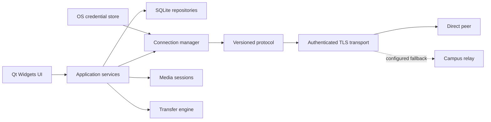
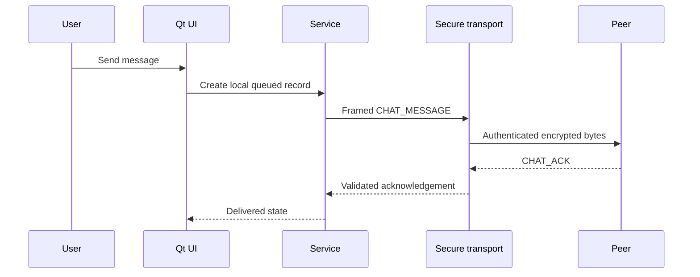

# Architecture

## Decisions

- **Qt Widgets via PySide6:** mature Windows desktop controls, high-DPI support, signals/slots,
  and less runtime overhead than a browser-based shell.
- **SQLite in WAL mode:** transactional local history with efficient concurrent readers. A
  migration ledger permits forward upgrades.
- **`asyncio` service boundary:** Phase 2 networking runs outside the UI thread and publishes
  immutable events to Qt through a bounded bridge.
- **TLS 1.3 plus device identity:** do not invent encryption. Phase 2 will use an audited TLS
  implementation and established asymmetric primitives, with OS credential protection.
- **Separate bulk and control channels:** prevents a large file transfer from starving chat,
  consent, heartbeat, or cancellation traffic.
- **Optional relay:** direct connections are preferred; an explicitly configured authorized
  relay is a routing aid, not a security bypass.

## Component view

Only UI, local configuration, SQLite, and framing primitives exist in Phase 1.

## Runtime model

The Qt main thread owns widgets. Network I/O will run on a dedicated asyncio loop. File hashing
and disk-heavy work will use bounded workers. Cross-thread events are typed, bounded, and sent
through Qt signals. Shutdown first stops acceptance of new work, persists resumable state, then
closes transport and database resources.

## Data flow

Transmission alone never means delivered; only an authenticated peer acknowledgement advances
that state.

## Phase gates

Each phase must keep the application runnable, add tests for its boundaries, update the threat
model, and report limitations. Distribution claims require clean-machine installer testing,
signed artifacts, dependency review, and an independent security review.

