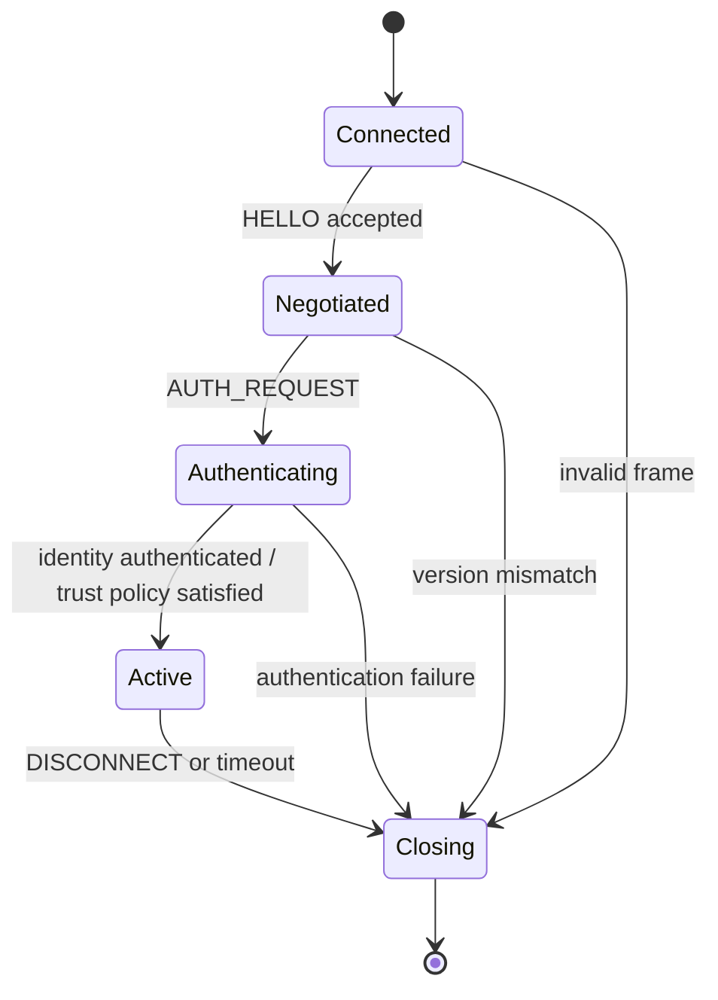

# Network Protocol (Initial Specification)

Status: partial implementation. Bounded framing and the authenticated single-request peer channel
are implemented; persistent connections and the bulk/media channels remain planned.

## Framing

Each control frame is `uint32_be length || UTF-8 JSON body`. The current control-frame maximum
is 4 MiB. File bytes and real-time media will use separate negotiated streams and are never
embedded in JSON. Receivers must handle fragmented and coalesced TCP reads.

Every body contains `version`, `type`, `id`, and an object `payload`. Unknown versions, unknown
message types, malformed UTF-8, duplicate IDs outside the replay window, and invalid state
transitions are rejected. Integers and strings receive schema-specific bounds.

## Connection state machine

Application data is forbidden before `Active`. Pairing is a separate explicit user-confirmation
flow. A known key change produces a blocking identity warning.

The implemented handshake runs over TLS 1.3. The client pins the server certificate fingerprint;
the server sends a random challenge, and the client signs it with the private key corresponding to
its trusted certificate. The client then challenges the server and confirms that its signed
identity matches the certificate used by TLS. Untrusted or changed fingerprints are refused.

## Initial message families

`HELLO`, `AUTH_REQUEST`, `AUTH_RESPONSE`, `CHAT_MESSAGE`, `CHAT_ACK`, `FILE_OFFER`,
`FILE_ACCEPT`, `FILE_RESUME`, `FILE_COMPLETE`, `HEARTBEAT`, and `DISCONNECT` are represented by
the Phase 1 enum. Screen/control/location/media schemas will be added only with their features.

File chunks use bounded binary records on a bulk channel with transfer ID, offset, size, and
authenticated integrity metadata. Paths use forward-slash relative form and are validated below
the receiver-selected root. Resume uses verified ranges, not an untrusted sender offset.

## Reliability

Message IDs provide deduplication. Conversation sequence numbers provide ordering. Acknowledgments
are idempotent. Retries use capped exponential backoff with jitter. Heartbeats detect stale links;
reconnect does not silently change peer identity. Per-channel queues and rate limits are bounded.
